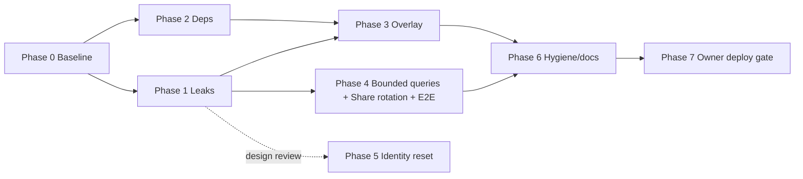

# Review Follow-ups — Implementation Plan v2 (Enhanced)

> **Agent:** Anti-Gravity pair — this document is the hand-off; any agent with repo write + shell can implement.
> **Verification mode:** Test + Browser-observable + Transform
> **Status:** Approved by user (2026-10-13)

## Goal Description

Close the security, correctness, performance and hygiene gaps found reviewing `main` (HEAD `e6e15af`) and the open items in `docs/recommendations.md`, in **independently committable phases**, security first.

## Decisions already made (from user feedback)

| Question | Decision |
|---|---|
| Scope | Phased; each phase a separate commit, security first |
| Backdrop overlay | **Fix it** (not revert) |
| Leaked `deviceId` remediation | Fix leaks now, document residual risk, plan a "reset device identity" follow-up |
| Rate limiting on public actions | **Out of scope** — recorded as accepted risk in `docs/recommendations.md` |
| Unnecessary scripts | **Deleted** `scripts/deploy*.py` completely |
| Vercel devDependency | **Remove** uncommitted `vercel` devDependency |

## User Review Required

> [!WARNING]
> **Accepted risk (rate limiting):** `geminiOCR` has *no* `deviceId` check, and `validateDeviceId` (`convex/auth.ts`) only rejects `""`, `"ssr"`, `"unknown"` — any string passes. Anyone who has the public Convex URL can call paid actions (Gemini, Places, Brave). This plan documents it as an accepted risk.

> [!IMPORTANT]
> **Owner-only actions (not done by the implementer):** `git push`, `npx convex deploy`, `npx vercel --prod`. Task 7 lists them. Deploy order matters: Convex first, then Vercel.

> [!CAUTION]
> Share links created *before* Phase 1 ships exposed the owner's `deviceId` in the page payload. Fixing the query stops new leaks but **cannot revoke IDs already seen**. Phase 5 (identity reset) is the only real remediation; until then those users' data remains readable by whoever opened their link.

## Review Evidence

Static baseline on `main`: `pnpm typecheck` ✅ · `pnpm lint` ✅ · `pnpm test` ✅ 153/20 files · `pnpm test:convex` ✅ 19/2 files · `pnpm build` ✅.

### Browser-verified: the new backdrop is broken

Playwright probe, Pixel 5, production build, `/explore`, 10 s after load:

| Probe | Result |
|---|---|
| `document.querySelectorAll("main").length` | **2** (duplicate landmark; layout already owns `main#main-content`) |
| Canvas present | yes |
| Canvas painted pixels (alpha sampled at t≈4 s and t≈10 s) | **0 and 0** — nothing is ever drawn |
| Wrapper `isolation` / `z-index` | `auto` / `auto` (canvas `-z-10` sits behind the wrapper's `bg-navy-950`) |

### Code-verified (findings summary)

| # | Sev | Finding | Where |
|---|-----|---------|-------|
| F1 | **Critical** | `shareView` returns raw `locationHistory`/`journalNotes` docs → includes `deviceId`, the sole credential for all device data | `convex/queries.ts` L156-175; no test asserts absence |
| F2 | **Critical** | `upcomingRemindersQuery` is a public `query`, no `deviceId` arg, returns *every* device's reminders incl. `deviceId`; only caller is the internal cron action | `convex/queries.ts`, `convex/actions.ts:965` |
| F3 | High | `pnpm audit --prod`: 8 advisories — `next` <15.5.27 (×2), `postcss` (via next, 2 high), `source-map-js` (high), `sharp` <0.35.5 (high) | audit output |
| F4 | High | Uncommitted `vercel` devDep adds ~2.7k lockfile lines + many dev advisories | `git diff package.json` |
| F5 | High | Overlay: confirmed above + code reading: image `onload` mutates a ref so `shouldAnimate` never re-evaluates (likely root cause of empty canvas); noise time-scale `t*0.0003` ≈ frozen; ±80/120 px drift vs ~2.5 % overhang; ignores app `reduce-motion` pref; no `visibilitychange` pause; per-frame `ctx.filter` blur (no Safari); 588 KB JPG not in SW precache; dead `mode`/`fixed` div; no tests | `src/components/ui/DragonflyDoubleOverlay.tsx`, `public/sw.js` |
| F6 | Medium | Unbounded `.collect()` in 5 queries (violates `convex/_generated/ai/guidelines.md`) | `convex/queries.ts` |
| F7 | Medium | Share token never rotates. **Auto-expiry can't be enforced in `shareView`** (queries must not read the clock) → manual rotation only | `docs/recommendations.md` |
| F8 | Medium | No E2E for the share happy path | `tests/e2e/share.spec.ts` |
| F9 | Low | Hygiene: unpushed `e6e15af`; untracked `convex/_generated/ai/` (policy: `_generated` is committed); stale counts in AGENTS.md (149/19 & 16 vs actual 153/20 & 19) | `git status` |
| F10 | Accepted | No rate limiting / weak `validateDeviceId` (see warning above) | `convex/auth.ts`, `convex/actions.ts` |

---

## Proposed Changes & Execution Phases

### Phase 0 — Baseline
- Record `git status` and test status in `docs/investigation-notes/2026-10-13-baseline.md`.
- Commit only that note.

### Phase 1 — Stop credential leaks (F1, F2) — P0
#### [MODIFY] `convex/queries.ts`
- Allow-list returned fields in `shareView` (strip `deviceId` from points and notes, omit raw doc spreading).
- Make `upcomingRemindersQuery` an `internalQuery` and bound with `take(MAX_DUE_REMINDERS)`.
#### [MODIFY] `convex/actions.ts`
- Change `sendDueReminders` caller reference to `internal.queries.upcomingRemindersQuery`.
#### [MODIFY] `convex-test/mutations.test.ts`
- Add tests confirming neither `deviceId` key nor deviceId value appears in `shareView` results.
- Test `internal.queries.upcomingRemindersQuery`.
#### Regenerate
- Run `npx convex codegen`; keep `_generated/` un-sorted per repository guidelines.

### Phase 2 — Dependencies (F3, F4)
#### [MODIFY] `package.json`, `pnpm-lock.yaml`
- Remove `vercel` dependency: `pnpm remove vercel`.
- Update vulnerable packages: `pnpm update next@^15.5.27 eslint-config-next@15.5.27 sharp@^0.35.5`.
- Verify `pnpm audit --prod` targets 0 high/critical issues.

### Phase 3 — Fix overlay (F5)
#### [MODIFY] `src/components/ui/DragonflyDoubleOverlay.tsx`
- Replace root wrapper element to avoid nesting multiple `<main>` landmarks (use `div` with `isolate`).
- Trigger animation using React state (`imgReady`) on image load rather than relying solely on ref mutations.
- Adjust drift frequency/amplitude to match canvas overhangs.
- Respect `prefers-reduced-motion` and `html.reduce-motion` setting.
- Pause rendering loop when document is hidden.
#### [MODIFY] `src/app/(tabs)/layout.tsx`
- Clean up call site.
#### [MODIFY] `public/sw.js`, `public/dragonfly-backdrop.jpg`
- Compress backdrop image, include in `PRECACHE_URLS`, and update cache name version.
#### [NEW] `tests/unit/DragonflyDoubleOverlay.test.tsx`
- Unit tests verifying clean DOM structure, proper canvas mounting, and reduced motion responsiveness.

### Phase 4 — Bounded queries, share rotation, E2E (F6–F8)
#### [NEW] `convex/limits.ts`
- Define bounding constants (`MAX_EXPENSES`, `MAX_REMINDERS`, `MAX_NOTES`, `MAX_TICKETS`, `MAX_DUE_REMINDERS`).
#### [MODIFY] `convex/queries.ts`
- Replace `.collect()` with `.take(MAX_*)` across all unbounded list queries.
#### [MODIFY] `convex/schema.ts`, `convex/mutations.ts`
- Add optional `shareTokenCreatedAt` field.
- Implement `rotateShare({ deviceId })` mutation.
#### [MODIFY] `src/components/journal/JournalClient.tsx`
- Add share rotation trigger with confirmation dialog in UI.
#### [MODIFY] `tests/e2e/share.spec.ts`
- Add E2E tests validating the complete share journey and rotation.

### Phase 5 — Device identity reset (follow-up design review)
- Design and review the device re-keying flow to safely migrate records when an ID was previously leaked.

### Phase 6 — Hygiene & docs (F9)
- Commit untracked `convex/_generated/ai/`.
- Ensure `scripts/deploy*.py` are removed/cleaned up.
- Update test counts and rules in `AGENTS.md`, `docs/task-status.md`, and `docs/recommendations.md`.

### Phase 7 — Owner deploy gate
- Check final status and hand off to owner for `npx convex deploy --yes` and production Vercel deployment.
