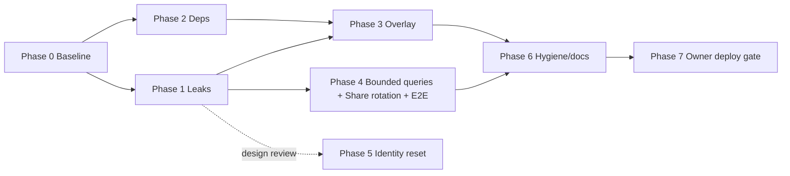

# Review Follow-ups — Implementation Plan v2 (Enhanced)

> **Agent:** Anti-Gravity pair — this document is the hand-off; any agent with repo write + shell can implement.
> **Verification mode:** Test + Browser-observable + Transform
> **Supersedes:** `docs/plans/2026-10-13-review-followups-plan.md` (v1, drafted before browser verification). On approval, v1 is overwritten with this version.

## Goal Description

Close the security, correctness, performance and hygiene gaps found reviewing `main` (HEAD `e6e15af`) and the open items in `docs/recommendations.md`, in **independently committable phases**, security first.

**Why v2:** v1 had unverified claims and missed a risk class. Since then I (a) built the app and probed the overlay in a real browser, (b) reviewed auth/API surface, (c) got your scope decisions.

## Decisions already made (from your answers)

| Question | Decision |
|---|---|
| Scope | Phased; each phase a separate commit, security first |
| Backdrop overlay | **Fix it** (not revert) |
| Leaked `deviceId` remediation | Fix leaks now, document residual risk, plan a "reset device identity" follow-up |
| Rate limiting on public actions | **Out of scope** — recorded as accepted risk in `docs/recommendations.md` |

## User Review Required

> [!WARNING]
> **Accepted risk (rate limiting):** `geminiOCR` has *no* `deviceId` check, and `validateDeviceId` (`convex/auth.ts`) only rejects `""`, `"ssr"`, `"unknown"` — any string passes. Anyone who has the public Convex URL can call paid actions (Gemini, Places, Brave). This plan only *documents* it. Say so if you want it promoted back in.

> [!IMPORTANT]
> **Owner-only actions (not done by the implementer):** `git push`, `npx convex deploy`, `npx vercel --prod`. Task 8 lists them. Deploy order matters: Convex first, then Vercel.

> [!CAUTION]
> Share links created *before* Phase 1 ships exposed the owner's `deviceId` in the page payload. Fixing the query stops new leaks but **cannot revoke IDs already seen**. Phase 5 (identity reset) is the only real remediation; until then those users' data remains readable by whoever opened their link.

## Open Questions

> [!NOTE]
> 1. **Phase 5 design** (device re-keying) is only sketched. I propose a design review after Phase 1 ships — OK?
> 2. The untracked `scripts/deploy*.py` duplicate the documented `npx` deploy commands and have a path bug (`Path(__file__).parent` → `scripts/`). Default in this plan: **leave untracked, don't commit**. Say if you want them fixed and kept.
> 3. `vercel` devDependency (uncommitted) pulls dozens of advisories incl. a *critical* in `tar`. Default: **remove it** (AGENTS.md uses `npx vercel`). Was it intentional?

## Review Evidence

Static baseline on `main`: `pnpm typecheck` ✅ · `pnpm lint` ✅ · `pnpm test` ✅ 153/20 files · `pnpm test:convex` ✅ 19/2 files · `pnpm build` ✅ (re-run this session). E2E not re-run (Phase 0 does it).

### Browser-verified: the new backdrop is broken

Playwright probe, Pixel 5, production build, `/explore`, 10 s after load:

| Probe | Result |
|---|---|
| `document.querySelectorAll("main").length` | **2** (duplicate landmark; layout already owns `main#main-content`) |
| Canvas present | yes |
| Canvas painted pixels (alpha sampled at t≈4 s and t≈10 s) | **0 and 0** — nothing is ever drawn |
| Wrapper `isolation` / `z-index` | `auto` / `auto` (canvas `-z-10` sits behind the wrapper's `bg-navy-950`) |


### Code-verified (not browser-reproduced)

| # | Sev | Finding | Where |
|---|-----|---------|-------|
| F1 | **Critical** | `shareView` returns raw `locationHistory`/`journalNotes` docs → includes `deviceId`, the sole credential for all device data | `convex/queries.ts` L156-175; no test asserts absence |
| F2 | **Critical** | `upcomingRemindersQuery` is a public `query`, no `deviceId` arg, returns *every* device's reminders incl. `deviceId`; only caller is the internal cron action | `convex/queries.ts`, `convex/actions.ts:965` |
| F3 | High | `pnpm audit --prod`: 8 advisories — `next` <15.5.27 (×2), `postcss` (via next, 2 high), `source-map-js` (high), `sharp` <0.35.5 (high) | audit output |
| F4 | High | Uncommitted `vercel` devDep adds ~2.7k lockfile lines + many dev advisories | `git diff package.json` |
| F5 | High | Overlay: confirmed above + code reading: image `onload` mutates a ref so `shouldAnimate` never re-evaluates (likely root cause of empty canvas); noise time-scale `t*0.0003` ≈ frozen; ±80/120 px drift vs ~2.5 % overhang; ignores app `reduce-motion` pref; no `visibilitychange` pause; per-frame `ctx.filter` blur (no Safari); 588 KB JPG not in SW precache; dead `mode`/`fixed` div; no tests | `src/components/ui/DragonflyDoubleOverlay.tsx`, `public/sw.js` |
| F6 | Medium | Unbounded `.collect()` in 5 queries (violates `convex/_generated/ai/guidelines.md`) | `convex/queries.ts` |
| F7 | Medium | Share token never rotates. **Auto-expiry can't be enforced in `shareView`** (queries must not read the clock) → manual rotation only | `docs/recommendations.md` |
| F8 | Medium | No E2E for the share happy path | `tests/e2e/share.spec.ts` |
| F9 | Low | Hygiene: unpushed `e6e15af`; untracked `convex/_generated/ai/` (policy: `_generated` is committed); stale counts in AGENTS.md (149/19 & 16 vs actual 153/20 & 19) | `git status` |
| F10 | Accepted | No rate limiting / weak `validateDeviceId` (see warning above) | `convex/auth.ts`, `convex/actions.ts` |

**Out of scope (log in recommendations.md):** React 19, Next 16, ESLint 10, Tailwind 4, framer-motion 14; `next lint` → ESLint CLI; dev-only `@lhci/cli` advisories without fixes; F10.

## Anti-Gravity boundary

- **Shared:** this plan, repo source, `AGENTS.md`, `convex/_generated/ai/guidelines.md` (**read before any Convex edit**).
- **Never touched/shared:** `.env.local`, Convex env values, VAPID keys, `android/android.keystore`, `android/keystore-passwords.txt`, real `deviceId`s or share tokens. Tests use generated IDs; never print tokens.
- **Dev deployment only** (`npx convex codegen`/`dev`). No prod deploy, no push.

## Phase map



Phases 1 and 2 are independent (may run in parallel subagents). One commit (or a few) per phase.

---

## Proposed Changes

### Phase 0 — Baseline
- Record `git status` and results of `pnpm typecheck && pnpm lint && pnpm test && pnpm test:convex && pnpm build && pnpm test:e2e` (`VITE_CONFIG_NATIVE_IGNORE_WARNING=true`) in `docs/investigation-notes/2026-10-13-baseline.md`. Do not stash/reset existing uncommitted edits.
- Commit only that note.

### Phase 1 — Stop credential leaks (F1, F2) — P0
#### [MODIFY] `convex/queries.ts`
```ts
// shareView — allow-list fields, never spread raw docs
return {
  shared: true as const,
  points: pointsDesc.reverse().map((p) => ({
    lat: p.lat, lng: p.lng, accuracy: p.accuracy, timestamp: p.timestamp,
  })),
  notes: notes.map((n) => ({
    _id: n._id, text: n.text, lat: n.lat, lng: n.lng, createdAt: n.createdAt,
  })),
  tripStartDate: prefs.tripStartDate ?? null,
};
```
```ts
// upcomingRemindersQuery: query -> internalQuery, bounded
import { internalQuery } from "./_generated/server";
export const upcomingRemindersQuery = internalQuery({ /* same args */ ... .take(MAX_DUE_REMINDERS) });
```
#### [MODIFY] `convex/actions.ts` (~L965)
`api.queries.upcomingRemindersQuery` → `internal.queries.upcomingRemindersQuery` (add `internal` import if missing; keep `as Reminder[]`). Verify no other callers: `grep -rn upcomingRemindersQuery src convex tests convex-test`.
#### [MODIFY] `convex-test/mutations.test.ts`
TDD: first add failing tests — `JSON.stringify(shareView)` contains neither the key `"deviceId"` nor the device's value; point keys ⊆ `{lat,lng,accuracy,timestamp}`; note keys ⊆ `{_id,text,lat,lng,createdAt}`; `internal.queries.upcomingRemindersQuery` returns due reminders across devices.
#### Regenerate
`npx convex codegen`; commit `_generated/` **unsorted** (AGENTS.md).
Also run the `convex-authz` skill read-only; log new findings, fix only trivial ones.

### Phase 2 — Dependencies (F3, F4)
#### [MODIFY] `package.json`, `pnpm-lock.yaml`
- `pnpm remove vercel`.
- `pnpm update next@^15.5.27 eslint-config-next@15.5.27 sharp@^0.35.5` (confirm they resolve; no major jumps).
- Target `pnpm audit --prod` → 0 high/critical. If `postcss`/`source-map-js` persist, try `pnpm.overrides` only if build + e2e stay green; else document blocked-upstream.
- Append deferred majors to `docs/recommendations.md`.

### Phase 3 — Fix overlay (F5)
Read first: `src/lib/utils/displayPrefs.ts`, `src/hooks/useDisplayPrefs.ts`, `tests/unit/DragonflyBackground.test.tsx` (canvas mock pattern).
#### [MODIFY] `src/components/ui/DragonflyDoubleOverlay.tsx`
- Wrapper → `div.relative.isolate.flex.flex-col.min-h-screen.bg-dragonfly-navy-950`; render `{children}` directly, **no `<main>`**. Remove `mode` prop + empty `fixed` div.
- `const [imgReady, setImgReady] = useState(false)` set in `onload`; `shouldAnimate = !reduced && mounted && imgReady`. Drop `crossOrigin`.
- Motion: noise frequency ≈ 0.05–0.08 (drift), ≈ 0.02 (scale/rot/opacity); clamp shift to overhang `maxShift = Math.max(0,(drawW-width)/2)`.
- Reduced motion = media query **or** `html.reduce-motion` (subscribe via matchMedia `change` + `MutationObserver` on `<html>` class) → static CSS background, no canvas.
- Perf: pause on `document.hidden`; ~30 fps cap; DPR ≤ 1.5; pre-render blur once offscreen (or drop); don't re-`getContext` per frame.
#### [MODIFY] `src/app/(tabs)/layout.tsx` — update call site (no `mode`).
#### [MODIFY] `public/sw.js`, `public/dragonfly-backdrop.jpg`
Recompress to ≤ ~150 KB (sharp, ~1080 px, q≈70); add to `PRECACHE_URLS`; bump `CACHE_NAME` → `moms-dragonfly-v4`.
#### [NEW] `tests/unit/DragonflyDoubleOverlay.test.tsx`
Children render; no `main`; media-query reduce → no canvas; `html.reduce-motion` → no canvas; otherwise canvas after mount (mock `getContext`/`Image`).
`pnpm lint -- --fix` (never hand-sort imports).

### Phase 4 — Bounded queries, share rotation, E2E (F6–F8)
#### [NEW] `convex/limits.ts`
`MAX_EXPENSES=1000, MAX_REMINDERS=500, MAX_NOTES=500, MAX_TICKETS=200, MAX_DUE_REMINDERS=500` (constants only).
#### [MODIFY] `convex/queries.ts`
Replace `.collect()` with `.take(MAX_*)` in expenses/reminders/tickets/journalNotes/upcomingReminders. Caveat: `BudgetDashboard` sums expenses client-side, so totals change past the cap — keep generous, note it. TDD: insert `MAX+1` rows via `t.run`, assert capped length + newest-first.
#### [MODIFY] `convex/schema.ts`, `convex/mutations.ts`
Add `shareTokenCreatedAt: v.optional(v.number())` (no migration). `enableShare` sets it only when minting. New `rotateShare({deviceId})`: `validateDeviceId`, `by_deviceId` `.unique()`, mint `crypto.randomUUID()`, patch token + createdAt, leave `shareEnabled` unchanged; return `null` if no prefs. **No expiry logic in `shareView`.** Tests: new token differs; old token → `{shared:false}`; device A rotation never touches device B.
#### [MODIFY] `src/components/journal/JournalClient.tsx`
Share card (only when enabled): "Create a new link" + confirm dialog ("The old link will stop working") + caption "Link created {date}". Mobile-first Tailwind, `--touch-target`, no `any`. Read the existing share UI first.
#### [MODIFY] `tests/e2e/share.spec.ts`
Happy path: add note → enable share → open URL in a **fresh context** (no localStorage) → assert heading, note, "Live" badge, and that the owner's `deviceId` (key in `src/lib/utils/deviceId.ts`) never appears in page content; rotate → old URL "Shared journal unavailable", new URL works. Fresh `deviceId` per test; dev deployment only.

### Phase 5 — Device identity reset (design review first)
Sketch, **not approved for implementation yet**: Settings → "Reset this device's identity": client generates a new UUID, calls `rekeyDevice({oldDeviceId,newDeviceId})` which moves `userPrefs`, `locationHistory`, `journalNotes`, `expenses`, `budgets`, `reminders`, `tickets` and `pois.deviceIds` in batches (scheduler continuation, per Convex guidelines), regenerates the share token, clears the old `vapidSubscription` handling, then updates localStorage. Inherent race: an attacker holding the old ID could call it first; document. Needs its own design pass.

### Phase 6 — Hygiene & docs (F9)
- Stage deliberately (no `git add -A`). Commit `convex/_generated/ai/`. Review `.agents/`, `.claude/`, `skills-lock.json` diffs; include only if intentional.
- `scripts/deploy*.py`: leave untracked (see Open Question 2).
- `AGENTS.md`: update test counts to **actual** post-phase numbers, keep the convex-ai block, add: "public functions must never return raw docs containing `deviceId`; cron-only functions must be `internal*`."
- Refresh `docs/task-status.md` and `docs/recommendations.md` (done items, deferred majors, F10 accepted risk, `shareView` payload cap note).

### Phase 7 — Owner gate (implementer does NOT execute)
`git push` → `npx convex deploy --yes` (before Vercel; Phase 1 removes a public function — no `src/` caller exists) → Vercel Ready check → `AGENTS.md` Post-Deploy Checklist (`curl -I` `/tesseract/*` and backdrop = 200, offline reload, `pnpm test:lhci`). Use `convex-deploy-guard` to classify the target first. Decide on rotating pre-fix share links / Phase 5.

---

## Verification Plan

### Automated Tests
```bash
export VITE_CONFIG_NATIVE_IGNORE_WARNING=true
pnpm typecheck && pnpm lint && pnpm test && pnpm test:convex
pnpm build && pnpm test:e2e
pnpm audit --prod        # Phase 2 target: 0 high/critical
grep -n "\.collect()" convex/queries.ts   # Phase 4 target: no matches
```

### Verify Visual & Transform Claims (per phase)

| Phase | Visual claim | Transform claim | Method | Result |
|---|---|---|---|---|
| 0 | none | baseline note exists | `cat` | PENDING |
| 1 | `/share/<token>` unchanged | `shareView` has no `deviceId`; `upcomingRemindersQuery` not publicly callable | new convex-tests; scratch `ConvexHttpClient` against **dev**: public call → "Could not find public function"; print `Object.keys` of a point/note only | PENDING |
| 2 | app unchanged (`/explore`, `/settings` smoke) | no `vercel` in `package.json`; `next` ≥ 15.5.27; small lockfile diff | `pnpm audit --prod`, `git diff --stat` | PENDING |
| 3 | faint dragonfly art visible behind `/explore`, `/budget`, `/journal`; layers drift; static with Reduce motion on | exactly one `<main>`; canvas pixels ≠ 0 and change between t0/t+5 s; SW `v4` precaches backdrop; file ≤ ~150 KB | Re-run the **same probe** used above (expect `mains:1`, sample ≠ 0 and changing; `0`-canvas under `.reduce-motion`), before/after screenshots, offline reload | PENDING |
| 4 | Journal share card shows "Link created <date>" + rotate dialog | token changes; old URL unavailable; no `.collect()` in `queries.ts` | Playwright screenshots, e2e, convex-tests | PENDING |
| 6 | none | `git status` only intentional paths; AGENTS counts = actual | `git status`, `git show --stat` per commit (catch stray `.superpowers/`, `docs/plans/`, workflow files) | PENDING |

### Manual Verification (you)
- On a phone: dragonfly art is visible and calm; toggle Settings → Display → Reduce motion → it goes static; battery/jank acceptable.
- Open an old share link before and after deploy — after Phase 4 rotation the old link must show "Shared journal unavailable".
- Decide Phase 5 and the Phase 7 deploy.

## Self-Review
1. **Coverage:** F1–F10 and every item in `docs/recommendations.md` map to a phase or an explicit exclusion.
2. **Placeholders:** none; files not yet read (JournalClient share UI, displayPrefs helper, `deviceId` key) are flagged "read first".
3. **Consistency:** `rotateShare`, `shareTokenCreatedAt`, `MAX_*`, `internal.queries.upcomingRemindersQuery` used identically throughout.
4. **Visual/transform verification:** every phase has a method; Phase 3 reuses the probe that found the bug, so the fix is measured, not assumed.
5. **Boundary:** shared vs. withheld stated; no secrets; deploy/push gated.
6. **Provenance:** versions/advisories are from local `pnpm audit`/`pnpm outdated` (2026-10-13); implementer must confirm patched versions resolve. Convex rules come from the repo's `guidelines.md`.

**Residual unknowns:** Phase 3 root cause is inferred (stale-ref `shouldAnimate`) — the probe will confirm after the fix. E2E baseline not yet recorded. A cookie-consent banner appeared overlapping the map placeholder in the screenshot; likely pre-existing layout — check in Phase 3 whether the wrapper change affects it.

## Execution Handoff
`subagent-driven-development`, one subagent per phase in the order above. After each, run `git show --stat HEAD` to reject stray files before accepting.
